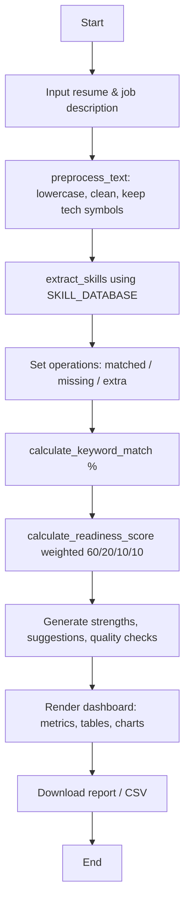

# Resume Analyzer Using Python and Streamlit with Embedded String Processing

### An Intelligent Resume Screening and Job Description Matching System Using Python String Operations

*A Master of Engineering Mini Project Report*

---

## 1. Title Page

| | |
|---|---|
| **Project Title** | Resume Analyzer Using Python and Streamlit with Embedded String Processing |
| **Subtitle** | An Intelligent Resume Screening and Job Description Matching System Using Python String Operations |
| **Application Name** | ResumeIQ — Smart Resume Analyzer |
| **Programme** | Master of Engineering (Mini Project) |
| **Technology** | Python, Streamlit |

---

## 2. Abstract

ResumeIQ is a web application that analyses a candidate's resume against a
target job description using classical **Python string-processing** techniques —
text normalisation, regular expressions, a dictionary-based skill vocabulary,
and Python **set** operations. It produces a transparent keyword-match score,
identifies missing skills, detects resume sections and contact information, and
generates actionable, rule-based suggestions and a downloadable report. The
system is deliberately free of external AI APIs, databases, and heavy NLP
frameworks: it runs fully offline and every computed value is explainable line
by line, which makes it well suited to academic demonstration and viva
examination. All sample resumes, job descriptions, and the skill dictionary are
stored as **embedded (triple-quoted) strings** inside the source code, so the
application is fully functional the moment it starts.

---

## 3. Introduction

Recruiters routinely perform a first-pass screen of resumes by checking whether
the keywords in a resume match the requirements of a job description. This
project reproduces that preliminary keyword screen in a transparent, educational
form. Rather than relying on opaque machine-learning models, ResumeIQ shows the
student (and the evaluator) exactly *how* a match score is produced — from
cleaning the text, through keyword extraction, to set-based comparison.

---

## 4. Problem Statement

Manual resume screening is slow, inconsistent, and hard to explain. At the same
time, candidates rarely get transparent feedback on *why* a resume does or does
not align with a job. There is a need for a simple, offline, explainable tool
that compares a resume to a job description using understandable rules and
clearly reports matched skills, missing skills, and a match score.

---

## 5. Objectives

1. Demonstrate Python string creation, manipulation, and **embedded strings**.
2. Apply regular expressions and rule-based matching to resume text.
3. Build a transparent, explainable keyword-match score.
4. Identify missing skills and generate actionable suggestions.
5. Provide an accessible Streamlit interface usable by non-programmers.
6. Keep the implementation offline, dependency-light, and testable.

---

## 6. Existing System

Typical existing solutions are commercial Applicant Tracking Systems (ATS) and
AI-based resume scorers. They are closed-source, often cloud-based, and their
scoring logic is not disclosed to the user.

### 7. Limitations of the Existing System

- Opaque scoring — users cannot see *why* a score was given.
- Usually require internet access and paid subscriptions.
- Privacy concerns from uploading resumes to third-party servers.
- Difficult to use as a teaching example because the logic is hidden.

---

## 8. Proposed System

ResumeIQ is an open, offline, fully transparent alternative. It uses only Python
string operations and a visible skill dictionary. Every score can be traced to a
specific, documented formula, and all sample data is embedded in the source.

---

## 9. Scope of the Project

**In scope:** text preprocessing, skill extraction, keyword matching, section
and contact detection, readiness scoring, skill-gap analysis, resume comparison,
batch screening, charts, and downloadable reports.

**Out of scope (future work):** semantic understanding, OCR for scanned PDFs,
machine-learning ranking, user authentication, and persistent databases.

---

## 10. Software and Hardware Requirements

**Software:** Python 3.11+ (tested on 3.14), Streamlit, pandas, Plotly, pypdf,
python-docx, a modern web browser.

**Hardware:** any laptop/desktop capable of running Python (≈4 GB RAM is ample).
No GPU or internet connection is required after installation.

---

## 11. System Architecture

```
┌──────────────────────────────────────────────────────────┐
│                      app.py (Streamlit UI)                 │
│   pages, widgets, charts, file upload, downloads           │
└───────────────┬───────────────────────────┬───────────────┘
                │ calls                       │ reads
                ▼                             ▼
      ┌────────────────────┐        ┌────────────────────────┐
      │    analyzer.py     │  uses  │     sample_data.py      │
      │  preprocessing,    │◄───────│  SKILL_DATABASE,        │
      │  matching, scoring │        │  SAMPLE_RESUMES,        │
      │  reports           │        │  SAMPLE_JOB_DESCRIPTIONS│
      └────────────────────┘        └────────────────────────┘
                ▲
                │ imported by
      ┌────────────────────┐
      │ tests/test_analyzer│
      └────────────────────┘
```

The UI layer (`app.py`) is cleanly separated from the logic layer
(`analyzer.py`) and the data layer (`sample_data.py`). The test suite imports
only the logic layer, which is why it can run without Streamlit.

---

## 12. Module Descriptions

- **sample_data.py** — embedded strings: the skill dictionary (a dictionary of
  lists), five sample resumes, five job descriptions, and a role→sample map.
- **analyzer.py** — the engine: `preprocess_text`, `extract_skills`,
  `calculate_keyword_match`, `calculate_readiness_score`, `detect_*`,
  `analyze_resume` (master function), `compare_resumes`,
  `analyze_multiple_resumes`, `extract_text_from_file`, `create_analysis_report`.
- **app.py** — Streamlit pages (Home, Analyze, Compare, Batch, Methodology,
  About), charts, uploads, and downloads.
- **tests/test_analyzer.py** — 30 unittest cases covering the required scenarios.

---

## 13. Data Flow

1. User supplies resume text + job description (paste / upload / sample).
2. `analyze_resume()` preprocesses both texts.
3. Skills are extracted from each using `SKILL_DATABASE`.
4. Set operations compute matched / missing / extra skills.
5. Scores (keyword match %, readiness) are computed.
6. Strengths, suggestions, quality checks, and a report are generated.
7. The UI renders metrics, tables, and charts; the user can download results.

---

## 14. Algorithm and Pseudocode

```
FUNCTION analyze_resume(resume, job):
    r_clean  = preprocess(resume)
    j_clean  = preprocess(job)
    r_skills = extract_skills(r_clean)      # set of skills in resume
    j_skills = extract_skills(j_clean)      # set of skills in job
    matched  = r_skills ∩ j_skills
    missing  = j_skills − r_skills
    IF size(j_skills) > 0:
        match% = size(matched) / size(j_skills) * 100
    ELSE:
        match% = 0                          # no division by zero
    readiness = 0.60*match%
              + 0.20*section_coverage%
              + 0.10*contact_completeness%
              + 0.10*readability%
    RETURN all results (clamped 0..100)
```

Skill-matching detail (safe matching):

```
FOR each skill:
    IF skill contains + # . / - :
        use look-around boundaries  (?<![a-z0-9+#]) skill (?![a-z0-9+#])
    ELSE:
        use word boundaries         \b skill \b      # \b stops "r" in "react"
```

---

## 15. Flowchart (Mermaid)



---

## 16. Database Design (and why a database is unnecessary)

The current version needs **no database**. All reference data (skills, sample
resumes, job descriptions) is small, static, and embedded in `sample_data.py`.
User-supplied resumes are processed in memory and intentionally **not**
persisted, for privacy. A database would add complexity (schema, connections,
migrations) without any benefit at this scale. If the project were extended to
store historical analyses or many candidates, a lightweight store such as SQLite
could be introduced — this is listed under Future Enhancements.

---

## 17. Implementation Methodology

The project was built in stages: (1) the data layer with embedded samples; (2)
the analysis engine with one function per feature plus a master
`analyze_resume()` that composes them, avoiding duplicated matching logic; (3)
the automated test suite, run to verify correctness; (4) the Streamlit UI on top
of the verified engine. This bottom-up order meant the UI was always built on a
tested foundation.

---

## 18. Python String-Processing Concepts Used

- **Embedded / triple-quoted strings** for all sample data.
- `str.lower()`, `str.split()`, `str.strip()`, `str.splitlines()`.
- **Regular expressions** (`re.sub`, `re.findall`, `re.search`, `re.compile`,
  word boundaries `\b`, look-around assertions).
- **Sets** and operations (`intersection`, `difference`) for keyword comparison.
- **Dictionaries** and **dictionary-of-lists** for the skill vocabulary.
- Comprehensions, loops, and conditionals throughout.

---

## 19. Streamlit Features Used

`st.set_page_config`, `st.sidebar`, `st.radio`, `st.selectbox`, `st.text_area`,
`st.text_input`, `st.file_uploader`, `st.button`, `st.download_button`,
`st.metric`, `st.tabs`, `st.expander`, `st.columns`, `st.dataframe`,
`st.plotly_chart`, `st.session_state`, and status messages
(`st.success`/`st.warning`/`st.error`/`st.info`).

---

## 20. Test Cases and Expected Results

| # | Test case | Expected result |
|---|-----------|-----------------|
| 1 | Well-matching resume | Match % > 50 |
| 2 | Resume with no matching skills | Matched = 0, match % = 0 |
| 3 | Empty resume | No crash, match % = 0 |
| 4 | Empty job description | No divide-by-zero, match % = 0 |
| 5 | Mixed-case text | Skills still detected |
| 6 | C++, C#, .NET, Node.js | All detected |
| 7 | Skill "R" | Matches language R, not "react"/"year" |
| 8 | Multiple emails | Email count ≥ 2 |
| 9 | Missing contact info | Email/phone = not found |
| 10 | Alternate section headings | Mapped to canonical sections |
| 11 | Malformed upload | Raises a friendly `ValueError` |
| 12 | Job description with no keywords | total keywords = 0, match % = 0 |
| 13 | Duplicate skills | Counted once |
| 14 | Repeated whitespace / blank lines | Flagged; stats correct |
| 15 | Two resumes, different coverage | Higher-coverage resume scores higher |

---

## 21. Actual Test Results (verified)

The suite in `tests/test_analyzer.py` was executed with:

```
python -m unittest discover -s tests
```

**Result (verified on Python 3.14.6): `Ran 30 tests ... OK` — all 30 tests
passed.** The 30 tests include every scenario in the table above. Students
should re-run the command on their own machine and capture the output for the
report.

---

## 22. Screenshots Checklist (for the student to capture)

Capture these yourself from your running app (this report does **not** fabricate
screenshots):

- [ ] Home page with metric cards.
- [ ] Analyze page with a sample loaded.
- [ ] Dashboard "Overview" tab (gauges + statistics).
- [ ] "Skills" tab with the category coverage chart.
- [ ] "Skill Gap" tab table.
- [ ] "Raw vs Clean" tab showing preprocessing.
- [ ] Downloaded Markdown report.
- [ ] Compare Resumes page.
- [ ] Batch Screening results + CSV download.
- [ ] Terminal showing `Ran 30 tests ... OK`.

---

## 23. Advantages

- Fully transparent and explainable scoring.
- Runs offline; no paid APIs or external servers.
- Privacy-friendly (in-memory processing).
- Beginner-friendly code; easy to defend in a viva.
- Works instantly with embedded sample data.

---

## 24. Limitations

- Keyword matching, **not** semantic understanding (risk of false negatives).
- Cannot judge real proficiency, seniority, or soft skills.
- Cannot guarantee ATS compatibility.
- Pattern-based detection can misfire on unusual formats.
- Scanned image-only PDFs are not supported (no OCR).

---

## 25. Future Enhancements

- Semantic matching with embeddings / transformer models.
- OCR for scanned PDFs.
- Weighted / required-vs-optional skills with learned weights.
- Persistent storage (SQLite) for historical analyses.
- Multi-language support and resume-formatting suggestions.

*(These are proposals and are **not** implemented in the current version.)*

---

## 26. Conclusion

ResumeIQ shows that a genuinely useful resume-screening tool can be built from
first principles using only Python string processing and a clean Streamlit
interface. Its transparency — every score traceable to a documented formula —
makes it both a practical preliminary-screening aid and an excellent teaching
artefact for demonstrating strings, regular expressions, and set theory in
Python.

---

## 27. References

- Python documentation — `re`, `string`, `unittest`:
  https://docs.python.org/3/library/
- Streamlit documentation: https://docs.streamlit.io/
- pandas documentation: https://pandas.pydata.org/docs/
- Plotly Python documentation: https://plotly.com/python/
- pypdf documentation: https://pypdf.readthedocs.io/
- python-docx documentation: https://python-docx.readthedocs.io/
